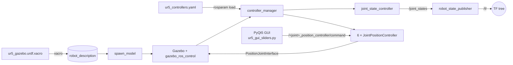
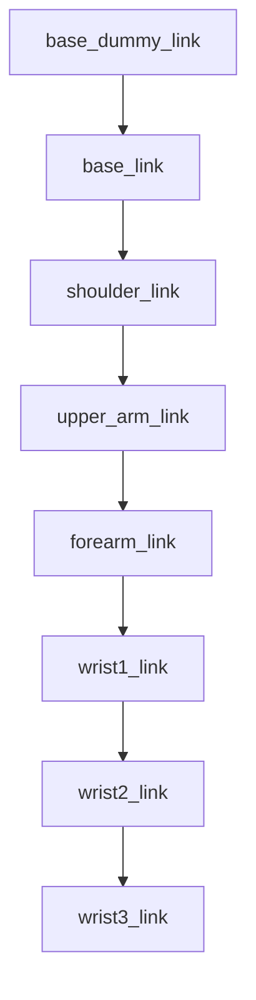

<div align="center">

# ⚙️ 6-DOF UR5 Robotic Arm: Physics Simulation in Gazebo with ROS Control

**A physics-based digital twin of a UR5-style industrial manipulator, simulated in Gazebo with inertial properties, collision geometry, ros_control PID position controllers and a custom PyQt5 GUI for real-time joint control.**

[](http://wiki.ros.org/noetic)
[](https://classic.gazebosim.org/)
[](http://wiki.ros.org/ros_control)
[](https://pypi.org/project/PyQt5/)
[](https://www.python.org/)
[](../LICENSE)


</div>

---

## 📑 Table of Contents

- [Overview](#-overview)
- [Demo](#-demo)
- [Features](#-features)
- [System Architecture](#-system-architecture)
- [Robot Model](#-robot-model)
- [Controllers & PID Tuning](#-controllers--pid-tuning)
- [PyQt5 Control GUI](#-pyqt5-control-gui)
- [Package Structure](#-package-structure)
- [Prerequisites](#-prerequisites)
- [Installation](#-installation)
- [Usage](#-usage)
- [ROS Topics](#-ros-topics)
- [Troubleshooting](#-troubleshooting)
- [Known Limitations](#-known-limitations)
- [Future Work](#-future-work)
- [Credits](#-credits)
- [License](#-license)
- [Author](#-author)

---

## 📌 Overview

Visualizing a robot in RViz shows its **kinematics**: how the links are connected and where they end up. A real robot also has mass, inertia and gravity acting on it, and it needs motors and controllers to move. Testing that behaviour on real hardware is expensive and risky.

This package takes the UR5-style arm into **Gazebo**, a physics simulator, and turns the model into a controllable digital twin:

- Each link has **mass and inertia**, so gravity and dynamics act on the arm.
- **Collision meshes** let Gazebo detect contacts between the arm and its surroundings.
- **Transmissions** connect every joint to a simulated actuator through `ros_control`.
- **Position controllers with PID gains** drive each joint to its target angle.
- A **PyQt5 slider GUI** sends joint commands in real time, so you never have to publish messages by hand.

---

## 🎬 Demo

<div align="center">

| UR5 Arm in Gazebo | PyQt5 Joint Control GUI |
|:---:|:---:|
|  |  |


*Gazebo simulation panel with the spawned UR5 model.*

</div>

---

## ✨ Features

- ✅ **Physics-ready URDF/Xacro** with mass, centre of mass and inertia tensor for every link
- ✅ **Mesh-based visual and collision geometry** for realistic rendering and contact detection
- ✅ **6 revolute joints** with position, effort and velocity limits
- ✅ **ros_control integration** through `SimpleTransmission` and `PositionJointInterface`
- ✅ **gazebo_ros_control plugin** to bridge Gazebo and ROS controllers
- ✅ **7 controllers**: one joint state controller and six joint position controllers
- ✅ **PID gains tuned per joint**, with stronger gains on the heavier shoulder and elbow joints
- ✅ **Custom PyQt5 GUI** with a slider for each joint
- ✅ **A single launch file** starts Gazebo, spawns the robot, loads the controllers and opens the GUI

---

## 🏗 System Architecture



| Component | Role |
|---|---|
| `xacro` | Expands the Xacro model into URDF and loads it into `robot_description` |
| `spawn_model` | Spawns the robot from `robot_description` into the Gazebo world |
| `gazebo_ros_control` | Gazebo plugin that exposes the simulated joints to `ros_control` |
| `controller_manager` / `spawner` | Loads and starts the controllers defined in the YAML file |
| `joint_state_controller` | Publishes the simulated joint angles on `/joint_states` at 50 Hz |
| `JointPositionController` × 6 | Moves each joint to the commanded angle |
| `robot_state_publisher` | Converts `/joint_states` into the TF tree |
| `ur5_gui_sliders.py` | PyQt5 window that publishes a target angle for each joint |

---

## 🦾 Robot Model

### Links

| Link | Mass (kg) | Inertia ixx = iyy = izz (kg·m²) | Mesh |
|---|:-:|:-:|---|
| `base_link` | 5.0 | 0.1 | base.dae |
| `shoulder_link` | 3.0 | 0.05 | shoulder.dae |
| `upper_arm_link` | 2.0 | 0.02 | upperarm.dae |
| `forearm_link` | 1.5 | 0.01 | forearm.dae |
| `wrist1_link` | 0.5 | 0.005 | wrist1.dae |
| `wrist2_link` | 0.4 | 0.004 | wrist2.dae |
| `wrist3_link` | 0.3 | 0.003 | wrist3.dae |

### Joints

| # | Joint | Parent → Child | Axis | Limits (rad) | Effort (N·m) | Velocity (rad/s) |
|:-:|---|---|:-:|:-:|:-:|:-:|
| 1 | `shoulder_joint` | base_link → shoulder_link | Z | ±1.57 | 200 | 1.0 |
| 2 | `upper_arm_joint` | shoulder_link → upper_arm_link | Y | ±1.57 | 200 | 1.0 |
| 3 | `forearm_joint` | upper_arm_link → forearm_link | Y | ±1.57 | 200 | 1.0 |
| 4 | `wrist1_joint` | forearm_link → wrist1_link | Y | ±1.57 | 200 | 1.0 |
| 5 | `wrist2_joint` | wrist1_link → wrist2_link | Y | ±1.57 | 200 | 1.0 |
| 6 | `wrist3_joint` | wrist2_link → wrist3_link | Y | ±1.57 | 200 | 1.0 |

Each joint has a `SimpleTransmission` with a mechanical reduction of 1, using `hardware_interface/PositionJointInterface`.

### TF Tree



---

## 🎛 Controllers & PID Tuning

All controllers are defined in [`config/ur5_controllers.yaml`](config/ur5_controllers.yaml).

| Controller | Type | Joint | P | I | D |
|---|---|---|:-:|:-:|:-:|
| `joint_state_controller` | JointStateController (50 Hz) | all | – | – | – |
| `shoulder_joint_position_controller` | JointPositionController | shoulder_joint | 150.0 | 0.01 | 5.0 |
| `upper_arm_joint_position_controller` | JointPositionController | upper_arm_joint | 150.0 | 0.01 | 5.0 |
| `forearm_joint_position_controller` | JointPositionController | forearm_joint | 150.0 | 0.01 | 5.0 |
| `wrist1_joint_position_controller` | JointPositionController | wrist1_joint | 80.0 | 0.01 | 3.0 |
| `wrist2_joint_position_controller` | JointPositionController | wrist2_joint | 80.0 | 0.01 | 3.0 |
| `wrist3_joint_position_controller` | JointPositionController | wrist3_joint | 80.0 | 0.01 | 3.0 |

**What each gain does:**

- **P (Proportional):** reacts to the current error. A high P gives a fast response.
- **I (Integral):** reacts to error that builds up over time. A small I removes long-term drift.
- **D (Derivative):** reacts to how fast the error changes. It damps the motion and reduces overshoot.

The shoulder, upper arm and forearm joints carry most of the arm's weight, so they use higher gains (P = 150, D = 5). The lighter wrist joints use softer gains (P = 80, D = 3).

---

## 🖥 PyQt5 Control GUI

[`scripts/ur5_gui_sliders.py`](scripts/ur5_gui_sliders.py) opens a **UR5 Joint Control GUI** window with one slider per joint.

- Slider range: **−157 to +157**, divided by 100, so each slider covers **−1.57 to +1.57 rad**, matching the joint limits.
- Moving a slider publishes a `std_msgs/Float64` on `/<joint>_position_controller/command`.
- The position controller then drives the joint in Gazebo to that angle.

<div align="center">

</div>

---

## 📂 Package Structure

```
6-DOF-Robotic-Arm-Gazebo-Simulation-UR5/   (ROS package: ur5_6dof_gazebo)
├── CMakeLists.txt
├── package.xml
├── README.md
├── urdf/
│   └── ur5_gazebo.urdf.xacro      # Physics-ready model: inertia, collisions, transmissions, plugin
├── meshes/                        # UR5 DAE meshes
├── config/
│   └── ur5_controllers.yaml       # Joint state + 6 position controllers with PID gains
├── launch/
│   └── ur5_gazebo.launch          # Gazebo + spawn + controllers + GUI
├── scripts/
│   └── ur5_gui_sliders.py         # PyQt5 slider GUI
└── Screenshots/                   # Images used in this README
```

---

## 🧰 Prerequisites

| Requirement | Version |
|---|---|
| OS | Ubuntu 20.04 LTS |
| ROS | Noetic Ninjemys |
| Simulator | Gazebo 11 |
| Python | 3.8+ |

```bash
sudo apt update
sudo apt install ros-noetic-gazebo-ros ros-noetic-gazebo-ros-control \
                 ros-noetic-ros-control ros-noetic-ros-controllers \
                 ros-noetic-joint-state-controller ros-noetic-position-controllers \
                 ros-noetic-effort-controllers ros-noetic-robot-state-publisher \
                 ros-noetic-xacro python3-pyqt5
```

---

## ⚙️ Installation

```bash
cd ~/catkin_ws/src
git clone https://github.com/Hafsa-Anwar65/UR5-6DOF-Robotic-Arm-ROS.git

# Make the GUI script executable
chmod +x UR5-6DOF-Robotic-Arm-ROS/6-DOF-Robotic-Arm-Gazebo-Simulation-UR5/scripts/ur5_gui_sliders.py

cd ~/catkin_ws
catkin_make
source devel/setup.bash
```

> ⚠️ The `chmod +x` step is required. Without it, `roslaunch` cannot start the GUI node.

---

## 🚀 Usage

### 1. Start the ROS master

```bash
roscore
```

### 2. Launch the simulation (new terminal)

```bash
source ~/catkin_ws/devel/setup.bash
roslaunch ur5_6dof_gazebo ur5_gazebo.launch
```

This single command:

1. Loads the robot description and controller parameters
2. Opens Gazebo with an empty world
3. Spawns the UR5 model
4. Starts `robot_state_publisher`
5. Loads and starts all 7 controllers
6. Opens the **UR5 Joint Control GUI**

When the controllers are ready, the terminal shows:

```
Started controllers: joint_state_controller, shoulder_joint_position_controller, upper_arm_joint_position_controller, forearm_joint_position_controller, wrist1_joint_position_controller, wrist2_joint_position_controller, wrist3_joint_position_controller
```

### 3. Move the arm

Drag the sliders in the GUI. Each joint moves in Gazebo in real time.

### 4. Command a joint from the terminal (optional)

```bash
rostopic pub -1 /forearm_joint_position_controller/command std_msgs/Float64 "data: 0.8"
```

### 5. Inspect the controllers

```bash
rosservice call /controller_manager/list_controllers
rostopic echo /joint_states
```

### Gazebo camera controls

| Action | Mouse |
|---|---|
| Zoom | Scroll wheel |
| Rotate view | Middle-click + drag / Shift + Left-click + drag |
| Pan | Left-click + drag |

---

## 📡 ROS Topics

| Topic | Type | Direction | Description |
|---|---|---|---|
| `/shoulder_joint_position_controller/command` | `std_msgs/Float64` | Subscribed | Target angle (rad) |
| `/upper_arm_joint_position_controller/command` | `std_msgs/Float64` | Subscribed | Target angle (rad) |
| `/forearm_joint_position_controller/command` | `std_msgs/Float64` | Subscribed | Target angle (rad) |
| `/wrist1_joint_position_controller/command` | `std_msgs/Float64` | Subscribed | Target angle (rad) |
| `/wrist2_joint_position_controller/command` | `std_msgs/Float64` | Subscribed | Target angle (rad) |
| `/wrist3_joint_position_controller/command` | `std_msgs/Float64` | Subscribed | Target angle (rad) |
| `/joint_states` | `sensor_msgs/JointState` | Published | Current joint angles |
| `/tf` | `tf2_msgs/TFMessage` | Published | Link transforms |

---

## 🛠 Troubleshooting

| Problem | Cause | Fix |
|---|---|---|
| `Cannot launch node of type [ur5_6dof_gazebo/ur5_gui_sliders.py]` | Script is not executable | `chmod +x scripts/ur5_gui_sliders.py` |
| `Could not load controller ...` | Controller packages missing | Install `ros-noetic-ros-controllers` and `ros-noetic-position-controllers` |
| Gazebo window stays black | First start loads models, or the VM's graphics are slow | Wait 1–2 minutes; in a VM, try `unset LIBGL_ALWAYS_SOFTWARE` |
| Very low Real Time Factor | Not enough CPU or GPU in the VM | Close other apps and give the VM more cores and RAM |
| Sliders move but the arm doesn't | Controllers not started | Run `rosservice call /controller_manager/list_controllers` and check they are `running` |
| `No p gain specified for pid` warnings | Gazebo reads PID gains from a different namespace | Harmless with `PositionJointInterface`; see Known Limitations |

---

## ⚠️ Known Limitations

- **The base is not anchored to the world.** The model can tip over when the upper arm moves far from vertical. Adding a `world` link with a fixed joint to `base_dummy_link` fixes the robot in place.
- **Simplified joint origins.** The joint offsets are simplified rather than taken from the real UR5 kinematics, so some meshes may overlap or leave small gaps.
- **Simplified inertia.** The inertia tensors are diagonal approximations, not values from CAD.
- **PID namespace warnings.** With `PositionJointInterface`, Gazebo sets joint positions directly, so it does not read the PID gains from the YAML file. The gains matter if you switch to `EffortJointInterface`.

---

## 🔮 Future Work

- [ ] Anchor the base to the world frame for full stability
- [ ] Use real UR5 joint offsets and joint limits (±2π)
- [ ] Switch to `EffortJointInterface` so the PID gains act as real torque control
- [ ] Add a `JointTrajectoryController` for smooth multi-joint trajectories
- [ ] Integrate **MoveIt** for motion planning and collision-free pick-and-place
- [ ] Add a gripper and objects to the Gazebo world

---

## 🙏 Credits

- **UR5 mesh files** come from [ros-industrial/universal_robot](https://github.com/ros-industrial/universal_robot) and are distributed under the BSD-3-Clause license. Universal Robots and UR5 are trademarks of Universal Robots A/S. This is an independent educational project and is not affiliated with Universal Robots.

---

## 📄 License

The original code in this package (URDF/Xacro, launch, config and Python files) is released under the [MIT License](../LICENSE).
The UR5 mesh files in `meshes/` keep their original **BSD-3-Clause** license from ROS-Industrial.

---

## 👩‍💻 Author

<div align="center">

**Hafsa Anwar**
*AI/ML & Robotics Engineer · BS Robotics & Intelligent Systems, Bahria University Karachi*

[](https://github.com/Hafsa-Anwar65)
[](https://www.linkedin.com/in/hafsa-anwar-53b251313)

⭐ If you found this project useful, consider giving it a star!

</div>
