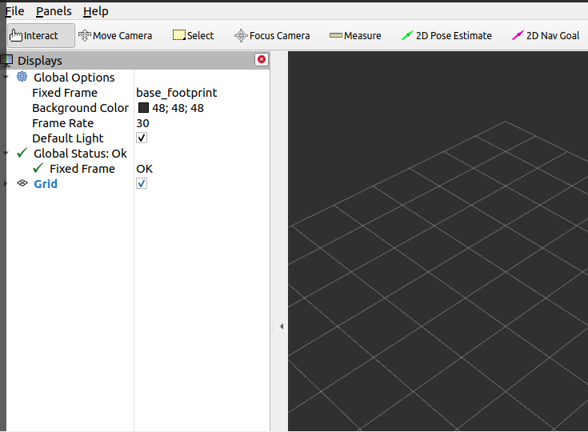
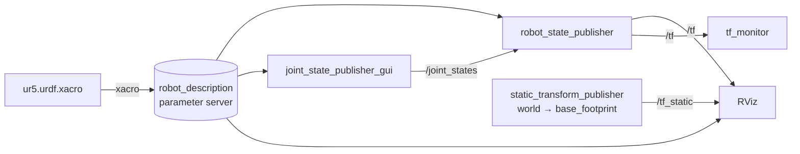
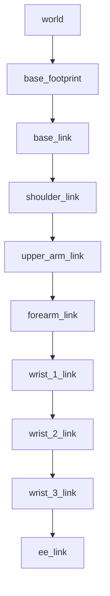

<div align="center">

# 🦾 6-DOF UR5 Robotic Arm Modeling with URDF/Xacro and RViz Visualization

**A ROS Noetic digital twin of a UR5-style industrial manipulator, with realistic meshes, a complete TF tree and interactive real-time joint control in RViz.**

[](http://wiki.ros.org/noetic)
[](https://releases.ubuntu.com/20.04/)
[](http://wiki.ros.org/xacro)
[](http://wiki.ros.org/rviz)
[](#-robot-specification)
[](../LICENSE)


</div>

---

## 📑 Table of Contents

- [Overview](#-overview)
- [Demo](#-demo)
- [Features](#-features)
- [Robot Specification](#-robot-specification)
- [System Architecture](#-system-architecture)
- [TF Tree](#-tf-tree)
- [Package Structure](#-package-structure)
- [Prerequisites](#-prerequisites)
- [Installation](#-installation)
- [Usage](#-usage)
- [Validating the Model](#-validating-the-model)
- [Troubleshooting](#-troubleshooting)
- [Learning Outcomes](#-learning-outcomes)
- [Future Work](#-future-work)
- [Credits](#-credits)
- [License](#-license)
- [Author](#-author)

---

## 📌 Overview

Industrial manipulators such as the **Universal Robots UR5** are widely used in automotive assembly, electronics manufacturing and laboratory automation. Because real hardware is expensive and access is limited, robotics engineers first build and validate a **digital twin** in simulation before deploying to a physical robot.

This package builds that digital twin in **ROS Noetic**:

- The arm is described in a single **URDF/Xacro** file covering its links, joints, joint limits, collision geometry and visual meshes.
- **Realistic DAE meshes** give the model an industrial appearance.
- **`robot_state_publisher`** computes and broadcasts the full TF tree from incoming joint states.
- **`joint_state_publisher_gui`** provides a slider for each of the six revolute joints, so the arm can be moved in real time.
- **RViz** renders the robot, its coordinate frames and its kinematic behaviour in 3D.

No physical hardware is required.

---

## 🎬 Demo

<div align="center">

| UR5 Arm in RViz | RViz Global & Display Settings |
|:---:|:---:|
|  |  |



</div>

---

## ✨ Features

- ✅ **6 revolute joints** with realistic position, effort and velocity limits
- ✅ **High-fidelity DAE meshes** for base, shoulder, upper arm, forearm and all three wrist links
- ✅ **Colour-coded links**, so each segment is easy to tell apart
- ✅ **Collision geometry** defined for every link
- ✅ **Complete TF tree** from `world` to the end-effector `ee_link`
- ✅ **Interactive joint control** through `joint_state_publisher_gui`
- ✅ **Pre-configured RViz layout** with RobotModel and TF
- ✅ **`tf_monitor`** included for debugging transform latency
- ✅ A single launch file brings the whole visualization up

---

## 📐 Robot Specification

| # | Joint | Type | Parent → Child | Axis | Limits (rad) | Effort (N·m) | Velocity (rad/s) |
|:-:|---|---|---|:-:|:-:|:-:|:-:|
| 1 | `shoulder_pan_joint` | Revolute | base_link → shoulder_link | Z | ±π | 150 | 3.15 |
| 2 | `shoulder_lift_joint` | Revolute | shoulder_link → upper_arm_link | Y | ±π | 150 | 3.15 |
| 3 | `elbow_joint` | Revolute | upper_arm_link → forearm_link | Y | ±π | 150 | 3.15 |
| 4 | `wrist_1_joint` | Revolute | forearm_link → wrist_1_link | Y | ±π | 28 | 3.2 |
| 5 | `wrist_2_joint` | Revolute | wrist_1_link → wrist_2_link | Z | ±π | 28 | 3.2 |
| 6 | `wrist_3_joint` | Revolute | wrist_2_link → wrist_3_link | Y | ±π | 28 | 3.2 |
| – | `base_footprint_to_base_link` | Fixed | base_footprint → base_link | – | – | – | – |
| – | `wrist_3_to_ee` | Fixed | wrist_3_link → ee_link | – | – | – | – |

**Key link lengths (UR5 geometry):** upper arm ≈ 0.425 m · forearm ≈ 0.392 m · shoulder offset ≈ 0.136 m

| Link | Colour |
|---|---|
| base_link | Gray |
| shoulder_link | Blue |
| upper_arm_link | Green |
| forearm_link | Yellow |
| wrist_1_link | Red |
| wrist_2_link | Orange |
| wrist_3_link | Purple |

---

## 🏗 System Architecture



| Node | Role |
|---|---|
| `xacro` | Expands the `.urdf.xacro` file into plain URDF and loads it into `robot_description` |
| `joint_state_publisher_gui` | Publishes the joint angles set on the sliders to `/joint_states` |
| `robot_state_publisher` | Reads the URDF and `/joint_states`, then publishes the TF tree at 50 Hz |
| `static_transform_publisher` | Anchors `base_footprint` to the `world` frame |
| `rviz` | Renders the robot model and TF frames in 3D |
| `tf_monitor` | Reports the latency of the `world → ee_link` transform chain |

---

## 🌳 TF Tree



---

## 📂 Package Structure

```
ur5_6dof_description/
├── CMakeLists.txt
├── package.xml
├── README.md
├── urdf/
│   └── ur5.urdf.xacro          # Complete robot description (links, joints, limits)
├── meshes/                     # UR5 visual meshes (DAE)
│   ├── base.dae
│   ├── shoulder.dae
│   ├── upperarm.dae
│   ├── forearm.dae
│   ├── wrist1.dae
│   ├── wrist2.dae
│   └── wrist3.dae
├── launch/
│   └── ur5_rviz.launch         # Brings up the full visualization pipeline
├── rviz/
│   └── ur5.rviz                # Saved RViz configuration
└── Screenshots/                # Images used in this README
```

---

## 🧰 Prerequisites

| Requirement | Version |
|---|---|
| OS | Ubuntu 20.04 LTS |
| ROS | Noetic Ninjemys |
| Build tool | catkin |

Install the required ROS packages:

```bash
sudo apt update
sudo apt install ros-noetic-xacro \
                 ros-noetic-robot-state-publisher \
                 ros-noetic-joint-state-publisher-gui \
                 ros-noetic-rviz \
                 ros-noetic-tf \
                 liburdfdom-tools
```

---

## ⚙️ Installation

```bash
# 1. Go to your catkin workspace's src folder
cd ~/catkin_ws/src

# 2. Clone the repository (contains both the RViz and Gazebo packages)
git clone https://github.com/Hafsa-Anwar65/UR5-6DOF-Robotic-Arm-ROS.git

# 3. Build the workspace
cd ~/catkin_ws
catkin_make

# 4. Source the workspace
source devel/setup.bash
```

> 📦 This package is part of the [UR5-6DOF-Robotic-Arm-ROS](https://github.com/Hafsa-Anwar65/UR5-6DOF-Robotic-Arm-ROS) repository. For physics simulation, see the [Gazebo package](../6-DOF-Robotic-Arm-Gazebo-Simulation-UR5).

> 💡 Add `source ~/catkin_ws/devel/setup.bash` to your `~/.bashrc` so you don't have to source the workspace in every new terminal.

---

## 🚀 Usage

### 1. Start the ROS master

```bash
roscore
```

### 2. Launch the visualization (in a new terminal)

```bash
source ~/catkin_ws/devel/setup.bash
roslaunch ur5_6dof_description ur5_rviz.launch
```

This opens two windows:

- **RViz**, showing the UR5 arm and its TF frames
- **Joint State Publisher**, with one slider for each of the six joints

### 3. Control the arm

- Drag any slider to rotate that joint, and the arm updates in RViz in real time.
- **Randomize** moves the arm to a random valid pose.
- **Center** returns every joint to 0 rad.

### 4. Navigate the 3D view in RViz

| Action | Mouse |
|---|---|
| Orbit around the robot | Left-click + drag |
| Zoom | Scroll wheel / Right-click + drag |
| Pan | Middle-click + drag / Shift + Left-click + drag |

### 5. Useful inspection commands

```bash
rostopic echo /joint_states             # Live joint angles
rosrun tf tf_echo world ee_link         # End-effector pose relative to world
rosrun rqt_tf_tree rqt_tf_tree          # Visual TF tree
rosparam get /robot_description | head  # Loaded robot description
```

---

## 🔍 Validating the Model

Expand the Xacro file and check the resulting URDF:

```bash
cd ~/catkin_ws/src/ur5_6dof_description/urdf
xacro ur5.urdf.xacro > /tmp/ur5.urdf
check_urdf /tmp/ur5.urdf
```

Expected output:

```
robot name is: ur5_robot
---------- Successfully Parsed XML ---------------
root Link: base_footprint has 1 child(ren)
    child(1):  base_link
        child(1):  shoulder_link
            child(1):  upper_arm_link
                child(1):  forearm_link
                    child(1):  wrist_1_link
                        child(1):  wrist_2_link
                            child(1):  wrist_3_link
                                child(1):  ee_link
```

Generate a PDF graph of the kinematic chain:

```bash
urdf_to_graphiz /tmp/ur5.urdf
```

---

## 🛠 Troubleshooting

| Problem | Cause | Fix |
|---|---|---|
| Only the grid is visible | Fixed Frame set to `map` (it doesn't exist) | Set **Global Options → Fixed Frame** to `world` |
| Robot appears as a flat white silhouette | Limited OpenGL support in a virtual machine | Run `export LIBGL_ALWAYS_SOFTWARE=1` before launching, or toggle 3D acceleration in the VM settings |
| `Could not load mesh resource` | Meshes missing or workspace not sourced | Check that `meshes/` contains all 7 `.dae` files, then run `source devel/setup.bash` |
| `joint_state_publisher_gui` not found | Package not installed | `sudo apt install ros-noetic-joint-state-publisher-gui` |
| Displays panel or toolbar missing | Hidden in the RViz layout | Enable **Panels → Displays** and **Panels → Tools**, then press `Ctrl+S` |
| `Resource not found: ur5_6dof_description` | Package not built or sourced | Run `catkin_make` and `source devel/setup.bash` |

---

## 🎓 Learning Outcomes

This project demonstrates:

1. Organising a ROS package with structured URDF, mesh, launch and RViz directories
2. Writing URDF/Xacro descriptions for a multi-link serial manipulator
3. Loading robot descriptions into the ROS parameter server
4. Using `robot_state_publisher` and `joint_state_publisher_gui` together for TF computation and interactive control
5. Configuring RViz for 3D visualization and debugging
6. Understanding the relationship between links, joints, meshes and TF frames
7. Visualizing forward kinematics and validating joint limits

---

## 🔮 Future Work

- [x] Add inertial properties and spawn the arm in **Gazebo** (see the [Gazebo package](../6-DOF-Robotic-Arm-Gazebo-Simulation-UR5))
- [ ] Integrate **MoveIt!** for motion planning and inverse kinematics
- [ ] Add a gripper end-effector (e.g. Robotiq 2F-85)
- [ ] Add `ros_control` joint trajectory controllers
- [ ] Write a Python node for scripted pick-and-place trajectories

---

## 🙏 Credits

- **UR5 mesh files** come from [ros-industrial/universal_robot](https://github.com/ros-industrial/universal_robot) and are distributed under the BSD-3-Clause license. Universal Robots and UR5 are trademarks of Universal Robots A/S. This is an independent educational project and is not affiliated with Universal Robots.

---

## 📄 License

The original code in this package (URDF/Xacro, launch and configuration files) is released under the [MIT License](../LICENSE).
The UR5 mesh files in `meshes/` keep their original **BSD-3-Clause** license from ROS-Industrial.

---

## 👩‍💻 Author

<div align="center">

**Hafsa Anwar**
*AI/ML & Robotics Engineer · BS Robotics & Intelligent Systems, Bahria University Karachi*

[](https://github.com/Hafsa-Anwar65)
[](https://www.linkedin.com/in/hafsa-anwar-53b251313)

⭐ If you found this project useful, consider giving it a star!

</div>
